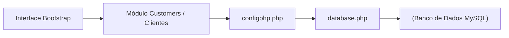

<p align="center">
  
</p>

<h1 align="center">crud-bootstrap-php-main2.0</h1>

<p align="center">Cadastro, consulta, edição e exclusão de clientes em uma aplicação web.</p>

<p align="center">
  
  
  
</p>

<p align="center"><a href="#visão-geral">Visão geral</a> &nbsp;·&nbsp; <a href="#recursos">Recursos</a> &nbsp;·&nbsp; <a href="#como-executar">Como executar</a></p>

---

## Visão geral

A aplicação organiza o ciclo de vida completo do registro de clientes em módulos reutilizáveis: cabeçalho e rodapé unificados, camada de configuração e acesso a banco de dados (configphp.php e database.php), e fluxos dedicados para listagem tabular, visualização de ficha detalhada, formulário de inclusão, edição cadastral e exclusão segura.

## Recursos

| Recurso | Como funciona |
|---|---|
| Listagem de clientes | Tabela responsiva em Bootstrap exibindo os registros ativos com ações rápidas por linha. |
| Cadastro e edição | Formulários estruturados para inserção e atualização dos dados cadastrais no MySQL. |
| Visualização de detalhes | Página individual para consulta completa dos dados de um cliente sem risco de edição acidental. |
| Exclusão de registros | Fluxo de remoção integrado ao banco de dados para manutenção da base. |
| Templates modulares | Inclusão de cabeçalho (headerin.php / inc/) e ativos estáticos locais (Bootstrap e Font Awesome). |

## Tecnologias

- **PHP** para processamento de formulários, roteamento de ações CRUD e comunicação com o banco;
- **MySQL** para armazenamento relacional dos registros de clientes;
- **Bootstrap & Font Awesome** empacotados localmente para garantir funcionamento mesmo em ambientes offline;
- **JavaScript** para interações de interface e modais de confirmação.

<details>
<summary>Arquitetura</summary>



A camada de apresentação reaproveita componentes visuais da pasta inc/, enquanto as operações de leitura e escrita são centralizadas nas funções de database.php configuradas por configphp.php.

</details>

<details>
<summary>Estrutura do repositório</summary>

```text
crud-bootstrap-php-main2.0/
├── assets/
│   └── project-animal.png          Emblema do projeto
├── customers/                      Páginas de listagem, adição, edição e visão
├── clientes/                       Versão modularizada do fluxo de clientes
├── inc/                            Cabeçalhos, rodapés e templates compartilhados
├── css/ & js/                      Bootstrap, Font Awesome e scripts locais
├── configphp.php                   Constantes de conexão e caminhos do sistema
├── database.php                    Funções de persistência e consultas SQL
└── index.php                       Painel inicial da aplicação
```

</details>

## Como executar

1. Clone o repositório dentro do diretório do seu servidor web (ex.: htdocs no XAMPP ou Laragon):
   ```bash
   git clone https://github.com/arthurlynow098/crud-bootstrap-php-main2.0.git
   ```
2. Crie o banco de dados MySQL e ajuste as credenciais (DB_NAME, DB_USER, DB_PASSWORD, DB_HOST) em configphp.php.
3. Inicie o Apache e o MySQL e acesse http://localhost/crud-bootstrap-php-main2.0/ no navegador.

## Decisões técnicas

- **Ativos locais:** manter o Bootstrap e o Font Awesome dentro do repositório evita quebras de layout em laboratórios sem acesso a CDNs externas.
- **Centralização de banco:** isolar as credenciais em configphp.php e as operações em database.php simplifica a migração entre ambientes locais.

---

<p align="center">
  <a href="https://github.com/arthurlynow098">GitHub</a> &nbsp;·&nbsp;
  <a href="https://arthurentsev.vercel.app/">Portfólio</a> &nbsp;·&nbsp;
  <a href="https://www.linkedin.com/in/entsevarthur/">LinkedIn</a>
</p>
