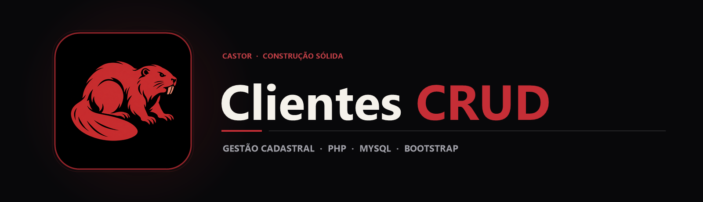

  

  Sistema web completo para cadastro, consulta, atualização e exclusão de clientes construído com PHP, MySQL e Bootstrap.

  
  
  

## Sobre o projeto

O gerenciamento de cadastros é a espinha dorsal de qualquer sistema comercial. Este repositório apresenta uma aplicação web **CRUD (Create, Read, Update, Delete)** em **PHP e MySQL**, projetada com layout responsivo em **Bootstrap** e iconografia **Font Awesome**.

A aplicação organiza o ciclo de vida completo do registro de clientes em módulos reutilizáveis: cabeçalho e rodapé unificados, camada de configuração e acesso a banco de dados (configphp.php e database.php), e fluxos dedicados para listagem tabular, visualização de ficha detalhada, formulário de inclusão, edição cadastral e exclusão segura.

## Principais recursos

| Recurso | Como funciona |
|---|---|
| Listagem de clientes | Tabela responsiva em Bootstrap exibindo os registros ativos com ações rápidas por linha. |
| Cadastro e edição | Formulários estruturados para inserção e atualização dos dados cadastrais no MySQL. |
| Visualização de detalhes | Página individual para consulta completa dos dados de um cliente sem risco de edição acidental. |
| Exclusão de registros | Fluxo de remoção integrado ao banco de dados para manutenção da base. |
| Templates modulares | Inclusão de cabeçalho (headerin.php / inc/) e ativos estáticos locais (Bootstrap e Font Awesome). |

## Tecnologias

  
  
  
  
  

- **PHP** para processamento de formulários, roteamento de ações CRUD e comunicação com o banco;
- **MySQL** para armazenamento relacional dos registros de clientes;
- **Bootstrap & Font Awesome** empacotados localmente para garantir funcionamento mesmo em ambientes offline;
- **JavaScript** para interações de interface e modais de confirmação.

## Arquitetura

`mermaid
flowchart LR
    A[Interface Bootstrap] --> B[Módulo Customers / Clientes]
    B --> C[configphp.php]
    C --> D[database.php]
    D --> E[(Banco de Dados MySQL)]
`

A camada de apresentação reaproveita componentes visuais da pasta inc/, enquanto as operações de leitura e escrita são centralizadas nas funções de database.php configuradas por configphp.php.

## Estrutura do repositório

`	ext
crud-bootstrap-php-main2.0/
├── assets/
│   ├── banner.png                  Banner principal do projeto
│   └── project-animal.png          Símbolo do castor
├── customers/                      Páginas de listagem, adição, edição e visão
├── clientes/                       Versão modularizada do fluxo de clientes
├── inc/                            Cabeçalhos, rodapés e templates compartilhados
├── css/ & js/                      Bootstrap, Font Awesome e scripts locais
├── configphp.php                   Constantes de conexão e caminhos do sistema
├── database.php                    Funções de persistência e consultas SQL
└── index.php                       Painel inicial da aplicação
`

## Executando o código

1. Clone o repositório dentro do diretório do seu servidor web (ex.: htdocs no XAMPP ou Laragon):
   `ash
   git clone https://github.com/arthurlynow098/crud-bootstrap-php-main2.0.git
   `
2. Crie o banco de dados MySQL e ajuste as credenciais (DB_NAME, DB_USER, DB_PASSWORD, DB_HOST) em configphp.php.
3. Inicie o Apache e o MySQL e acesse http://localhost/crud-bootstrap-php-main2.0/ no navegador.

## Decisões técnicas

- **Ativos locais:** manter o Bootstrap e o Font Awesome dentro do repositório evita quebras de layout em laboratórios sem acesso a CDNs externas.
- **Centralização de banco:** isolar as credenciais em configphp.php e as operações em database.php simplifica a migração entre ambientes locais.

---

Estudo · construção · evolução <a href="https://github.com/arthurlynow098">Perfil</a> · <a href="https://arthurentsev.vercel.app/">Portfólio</a> · <a href="https://www.linkedin.com/in/entsevarthur/">LinkedIn</a>

